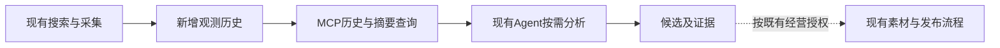

# ai-goofish-monitor 集成评估

评估日期：2026-11-04。范围：克隆、源码比较、许可证与复用成本评估；本轮未实施业务集成。

## 结论与优先级

保留 MaoYuOps 的采集、数据库、账号、MCP 和交付架构，优先补「竞品观测历史 → MCP 查询 → 现有 Agent 分析」。参考项目最有价值的是历史记录和分析组织方式，整套爬虫、Vue 页面与 SQLite 不宜直接搬入。

建议按以下顺序做三个功能包：

1. **竞品观测历史与需求证据：第一优先。** 留下同一商品多次采样的价格、想要数、浏览量及来源，再输出可比变化。原项目已经有价格历史；想要数/浏览量的历史与增长分析是我们需要新增的部分。
2. **规则与可解释的候选筛选：第二优先。** 先用低成本规则和现有 Agent，必要时再加可选的后台文字/图文 AI 分析。保存依据、缺失项和分析版本，适配虚拟商品选品。
3. **采集任务故障暂停、恢复与告警：第三优先。** 在现有账号冷却和通知渠道上补齐持久状态与通知去重，便于区分登录失效、部分成功、模型失败和等待人工验证。

这些功能增强「调研与选品」，不把采集结果直接变成卖家资源、商品发布、私信或订单发货。

## 来源、克隆与边界

- 参考仓库：[Usagi-org/ai-goofish-monitor](https://github.com/Usagi-org/ai-goofish-monitor)。
- 克隆位置：工作区 `reference-projects/ai-goofish-monitor/`，与主项目并列；浅克隆，无子模块递归、无依赖安装，整个目录约 7.6 MB。
- 核对版本：`master`，提交 `77f8d75869acd65f9dba72731b95c7c49ea67bdf`（2026-10-10）。以下外部源码链接固定到该提交。
- 参考许可证：[MIT](https://github.com/Usagi-org/ai-goofish-monitor/blob/77f8d75869acd65f9dba72731b95c7c49ea67bdf/LICENSE)，版权行 `Copyright (c) 2025 dingyufei615`。后续实质复制/改编代码时保留相应版权与许可文本、记录提交；MaoYuOps 原 AGPL-3.0 授权保持。
- 主项目基线：`ac03d0251e52ecc3ea94ffd35d871181672ee967` 加本机已有 21 个变更路径；本评估基于当前工作区，保留这些变更。
- 只读取参考源码、依赖清单和相关测试文件；没有启动它的应用、执行仓库脚本、连接运营账号或调用付费模型。本轮新增费用为 0。

参考仓库 `AGENTS.md` 的部分运行说明仍提及 JSONL；当前结果与价格历史主实现已使用 SQLite，集成判断以实际服务代码和表结构为准。

## 现有能力与真实缺口

| 功能 | 参考项目实现 | MaoYuOps 当前情况 | 集成判断 |
| --- | --- | --- | --- |
| 上新/价格条件监控 | Playwright 搜索、条件过滤、定时进程 | 已有上新/降价监控、价格和发布时间过滤、采集任务 | 沿用现有引擎，不重复部署 |
| 观测历史与价格统计 | 多轮价格快照、按日去重、均价/中位数/范围、单品历史 | 监控商品保存最新 `price/want_count/raw_json/last_seen_at`，更新时覆盖；未找到对应的追加式竞品历史模块 | 最值得参考，存储层需适配 |
| 想要数和浏览量补全 | 搜索 `wantNum` 后，再用详情 `wantCnt/browseCnt` 补充 | 列表标签解析已有；数据罗盘也支持限量详情补全 | 统一已有通路和来源标记，不重造详情浏览器 |
| 关键词预筛 | 大小写归一、去重、英文数字词边界、任意命中及命中计数 | 任务以关键词搜索和平台条件为主；尚无同等候选分析记录 | 纯函数较易抽取，但仅是单组 OR，并非任意布尔表达式引擎 |
| 图文 AI 分析流程 | 分发器组织卖家补全、图片、AI、保存、通知 | 已有 AI 文本/图片客户端、回复和上架任务；现有监控缺这一套候选分析记录与版本状态 | 参考工作流，复用己有模型配置和客户端 |
| 缓存与请求合并 | 卖家信息 TTL 缓存，同一卖家的并发请求合并 | 已有 Redis、账号冷却和部分请求级缓存 | 可借鉴方法，第一期不必采集完整卖家画像 |
| 失败暂停与恢复 | 连败计数、暂停期限、登录态文件变更恢复、限频通知 | 已有采集成功/失败/部分成功日志、进程内账号冷却、通知渠道 | 增补持久任务状态和恢复依据，不照搬 JSON 文件 |
| 管理界面与导出 | Vue 结果页、价格趋势、任务进度 | 已有 React 监控总览、商品和日志页，已安装 Recharts | 借鉴交互，复用现有页面与图表依赖 |
| Agent 入口 | Web/HTTP API 为主；未见内置运营 MCP/Skills 包 | 已有 MCP、稳定操作编号与运营 Skill，但监控路由未列入 MCP 白名单 | 从现有结果查询补小范围 MCP 能力 |

主项目证据：[监控任务](../../common/models/listing_monitor_task.py)、[采集商品](../../common/models/listing_monitor_item.py)、[最新值更新](../../scheduler/app/services/scheduler/listing_monitor_task.py)、[详情补全](../../backend-web/app/services/compass/goofish_compass.py)、[MCP 白名单](../../backend-web/app/mcp/catalog.py)。

## 第一优先：竞品观测历史与 MCP 查询

### 可以复用什么

参考 [price_history_service.py](https://github.com/Usagi-org/ai-goofish-monitor/blob/77f8d75869acd65f9dba72731b95c7c49ea67bdf/src/services/price_history_service.py) 的采样、按商品去重、按日趋势和价格统计思路；这些算法比 SQLite 写入代码更适合复用。它的快照记录在模型分析之前，能把采集事实和 AI 判断分开。

原快照只有价格等市场字段，**没有想要数/浏览量的独立历史字段**。不能把它现有的价格趋势直接描述为需求增长分析。

### 在本项目怎样接入

- 保留 `xy_listing_monitor_items` 作为最新记录，新增市场观测历史表（建议名 `xy_market_observations`）；不修改本人商品表 `xy_catalog_items` 的在售状态，不影响卡券、AI 回复和订单关系。
- 用现有 MySQL + SQLAlchemy 异步会话实现追加记录，替换外部 SQLite 的 `?` 参数和 `INSERT OR IGNORE`；不要再引入一套 SQLite/JSONL 业务主库。
- 观测至少带上归属用户、任务/查询范围、商品 ID、采样时间/批次、价格、想要数、浏览量、字段来源及采样完整性。数值缺失用空值，保留必要的原始标签，不把缺字段写成 0。
- 想要数来源分开标记：搜索标签、详情字段、不可获取。参考项目的[详情补全](https://github.com/Usagi-org/ai-goofish-monitor/blob/77f8d75869acd65f9dba72731b95c7c49ea67bdf/src/scraper.py#L1107)可作流程参考；本项目优先复用已有详情逻辑，只有确需时才抽取公共客户端。
- 至少两次来源/口径可比的同商品观测，才给出增长值；字段来源改变、计数回落或采样失败时标注不可比，不把列表缺失当售罄或违规，也不把累计想要数当销量。
- 价格统计注明关键词、过滤条件、样本量与时点；这是挂牌价和抽样结果，不是市场成交价。一次失败不覆盖旧观测；部分采集保留部分标记。

### Agent 与页面入口

先提供三类读取能力：**当前采集结果、单品观测历史、关键词样本摘要**。现有监控的任务/商品/日志 GET 路由可逐个审查后加入 MCP 白名单；历史查询新建小接口即可。按用户归属过滤并限制分页/时间范围，不能把管理员页面能看到的数据全部开放给普通业务令牌。

默认先支持按需查询和现有任务结果分析。创建监控规则、持续运行、付费模型及发布动作分别遵循已有授权；若后续开放监控配置写工具，单独设计权限，不借“重新上架规则”权限扩大已有密钥能力。

界面先在现有采集商品详情增加历史记录/趋势和最近检查时间，复用 `frontend/src/pages/product-monitor/` 及现有 Recharts；不新建另一套管理后台。

## 第二优先：规则与可解释的候选分析

可参考 [关键词预筛](https://github.com/Usagi-org/ai-goofish-monitor/blob/77f8d75869acd65f9dba72731b95c7c49ea67bdf/src/keyword_rule_engine.py) 和 [分析分发器](https://github.com/Usagi-org/ai-goofish-monitor/blob/77f8d75869acd65f9dba72731b95c7c49ea67bdf/src/services/item_analysis_dispatcher.py)，但不整包导入 `src`：

1. 先对采集字段做统一映射；规则返回命中项和理由，减少不必要的模型请求。原引擎是「任意命中即推荐」，如需必选/排除/组合条件，要明确扩展和验证。
2. 第一阶段可由已有 MCP Agent 读取样本和历史分析，不必马上在服务器常驻另一套付费模型流程。后续需要后台批量筛选时，再接入现有 `common/services/ai_text_client.py` 等配置/客户端，避免复制全局 `OPENAI_API_KEY` 管理方式或覆盖销售聊天配置。
3. 推荐结论与观测事实分开存；记录输入观测、规则/提示词/模型版本、理由、缺失证据、运行状态和调用消耗。重新分析时按内容及策略版本去重，避免每次轮询都对所有旧商品重跑模型。
4. 虚拟商品的标准围绕具体需求、教程/整理的交付价值、使用条件、竞争与可核对的许可信息。外部默认提示词偏二手实物的电池、维修和卖家画像，不能直接作为虚拟商品评判标准。发布前仍沿用现有 [合规流程](../../skills/xianyu-operations/references/compliance.md) 和 [选品流程](../../skills/xianyu-operations/references/selection.md)。
5. 文字规则和文字分析先行；图像分析是可选阶段，须模型实际支持且费用已获准。图片设置数量、大小、下载和分析并发边界，任务结束清理临时文件。

### 不能原封搬入的细节

- 分发器有 `Semaphore` 限制活动分析并发，但 `submit()` 仍逐条创建任务；移入常驻 Scheduler 时还需限制排队数量，不能把活动并发上限当作队列上限。
- 其 `_skip_ai_analysis` 分支把 `is_recommended` 设为真。新模块应区分「跳过、未分析、失败、分析成功」与推荐结论，不能把未分析包装成 AI 已推荐。
- 分发器即使保存函数返回假，仍可能继续通知。集成时先保存结果和待通知状态，通知再以稳定事件编号处理，保证通知可追溯、可去重。
- [结果去重](https://github.com/Usagi-org/ai-goofish-monitor/blob/77f8d75869acd65f9dba72731b95c7c49ea67bdf/src/services/result_storage_service.py)按关键词结果集合加载已处理链接。同关键词、不同标准的任务可能互相影响；本项目应区分用户、任务/策略版本和商品，而不是仅按关键词永远跳过旧商品。

## 第三优先：失败暂停、恢复和告警

参考 [FailureGuard](https://github.com/Usagi-org/ai-goofish-monitor/blob/77f8d75869acd65f9dba72731b95c7c49ea67bdf/src/failure_guard.py)：累计失败、暂停期限、通知限频和登录态更新后恢复都有现成思路。

本项目已有 [账号冷却](../../common/services/account_cooldown.py)、监控日志和通知渠道，适合扩展而非另起文件守护器：

- 任务失败状态落 MySQL，临时协调可使用现有 Redis，键包含用户和任务 ID；不依赖外部 JSON 状态文件或任务显示名称。
- 区分登录失效、平台验证、网络波动、解析变化、模型失败和部分成功，保留错误与最后成功时间；暂停采集不删除已有结果。
- 参考项目根据登录态文件修改时间解除暂停。主项目应在登录态验证成功后恢复原获准任务，不因 Cookie 文本变化就认定登录已恢复，也不自动启用用户手动停用的账号。
- 复用已有通知渠道，保存通知事件状态、限频并去重；配置缺失/通知失败需要可见。通知日志只记渠道 ID/类型，不输出完整渠道配置。
- 采集恢复不等于旧订单已补发。订单仍需独立检查付款、退款、已发送记录和原卡券；不拿采集任务的重试逻辑去重发真实订单。

## 不建议整套搬入

| 部分 | 原因与替代方式 |
| --- | --- |
| Playwright 搜索及登录态导出体系 | 本项目已有浏览器搜索、直接 MTOP 采集和账号维护，复用现有能力；详情请求只按需限量补充 |
| SQLite、JSON 任务状态和单用户文件目录 | 本项目已有多用户 MySQL/Redis；移植算法，重做归属与异步持久化适配 |
| Vue 页面与另一套 Web 登录 | 本项目是 React，保留统一账号、布局和页面，只借鉴交互 |
| 原模型连接管理与默认推荐提示词 | 已有模型客户端和配置，评判目标也不同；不要影响现有销售回复 |
| 完整卖家画像、代理/账号轮换流程 | 当前优先解决虚拟商品需求证据；额外资料请求会增加采集开销，不作为自动发货或准入保证 |

## 建议首期范围与验收

首期只打通：现有采集结果 → 历史观测 → MCP 历史/摘要查询 → Agent 给出带证据的候选。

- 成本判断：历史存储与查询涉及模型、采集落库、API/MCP、页面，属中等改动；关键词纯函数适配较小；完整后台图文 AI 管线及故障恢复另成后续阶段，不在首期一起铺开。
- 首期不新增模型请求和付费服务，按实际采样量再决定后续模型预算；本评估没有性能实测或固定工时承诺。
- 同商品多次采样可回看历史；未知人数不冒充 0，采集失败保留旧数据，口径不一致不生成增长结论。
- MCP 只返回本人可见的观测，查询有分页与时间范围，已有商品、卡券、AI 回复、订单及其他任务配置保留。
- 新选品流程不配置自动下单/私信，不将竞品图文直接写入发布素材；现有获准任务不做无关改动。
- 实施后按项目约定做云端隔离回归，再在当轮授权下做小样本真实采集/模型验收；新图文调用、持续监控与部署另按实际范围执行。

## 本轮验证与限制

已完成浅克隆、提交/许可证核对、源码和依赖对照，并静态索引了价格历史、关键词、缓存、分析并发、失败暂停、AI 响应解析共 6 个测试文件（19 条测试定义），供迁移回归使用。本轮没有执行测试或业务采集，因此不作测试通过、模型效果或生产稳定性的结论。

克隆目录保持干净，主项目原有修改以哈希清单核对；私有研究记录位于 `data/ops-runs/monitor-integration-analysis-20261104/`。本轮只新增本评估文档，不代表上述集成方案已实现或已上线。
